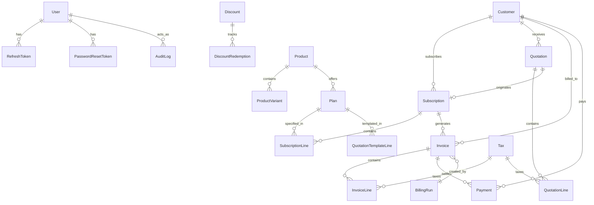

# Brightloop Database Architecture

## 1. Relational Entity-Relationship Model

The PostgreSQL schema is managed via Prisma ORM 5 with strict foreign keys, cascade rules, composite indexes, and unique constraints.



---

## 2. Table Catalog

| Table | Map | Purpose | Key Indexes |
| :--- | :--- | :--- | :--- |
| `User` | `users` | System user credentials, Argon2 hash, lockout counters | `email (unique)`, `role` |
| `RefreshToken` | `refresh_tokens` | Active JWT refresh tokens for session rotation | `token (unique)`, `userId` |
| `Customer` | `customers` | Client directory, address, GSTIN, soft-delete state | `customerNumber (unique)`, `email` |
| `Product` | `products` | Core product catalog | `sku (unique)`, `isActive` |
| `ProductVariant` | `product_variants` | Product options, SKUs, and interval prices | `sku (unique)`, `productId` |
| `Plan` | `plans` | Recurring billing tiers, trial days, feature lists | `productId`, `billingInterval` |
| `Tax` | `taxes` | GST/VAT rates stored in basis points | `name`, `type` |
| `Discount` | `discounts` | Percentage/fixed coupon codes, usage and customer limits | `code (unique)`, `isActive` |
| `DiscountRedemption`| `discount_redemptions` | Immutable discount redemption logs | `discountId`, `customerId` |
| `Quotation` | `quotations` | Proposals with totals, line calculations & expiration | `quotationNumber (unique)`, `customerId` |
| `QuotationLine` | `quotation_lines` | Itemized quotation rows | `quotationId` |
| `Subscription` | `subscriptions` | Active recurring plans, periods & lifecycle state | `subscriptionNumber (unique)`, `customerId` |
| `SubscriptionLine` | `subscription_lines` | Plan assignments to a subscription | `subscriptionId`, `planId` |
| `Invoice` | `invoices` | Financial demand notes with subtotal, tax, paid & due | `invoiceNumber (unique)`, `customerId`, `subscriptionId` |
| `InvoiceLine` | `invoice_lines` | Historical snapshot of billed items & applied taxes | `invoiceId` |
| `Payment` | `payments` | Append-only financial ledger of payments received | `paymentNumber (unique)`, `invoiceId` |
| `Sequence` | `sequences` | Atomic sequence generator for human-readable IDs | `prefix (unique)` |
| `BillingRun` | `billing_runs` | Automated recurring billing batch run statistics | `startedAt`, `status` |
| `AuditLog` | `audit_logs` | Immutable audit log of all system changes | `actorId`, `entity, entityId`, `createdAt` |
| `EmailLog` | `email_logs` | Outgoing notification log | `to`, `type`, `sentAt` |

---

## 3. High-Concurrency Guarantees

1. **Atomic Sequence Generation:**
   Unique numbers (`INV-000001`, `QUO-000001`, `PAY-000001`) use PostgreSQL atomic updates:
   ```sql
   INSERT INTO sequences (id, prefix, next_value, updated_at)
   VALUES (gen_random_uuid(), 'INV', 2, NOW())
   ON CONFLICT (prefix)
   DO UPDATE SET next_value = sequences.next_value + 1, updated_at = NOW()
   RETURNING next_value - 1 as next_value;
   ```
2. **Race-Condition-Free Discount Redemptions:**
   Redemption uses `SELECT ... FOR UPDATE` row-level locks on the Discount record to verify limits and increment `currentUsage` in a single ACID transaction.
3. **Idempotent Recurring Billing:**
   Recurring billing cycles check if an invoice already exists for the matching subscription and billing period prior to generation.
